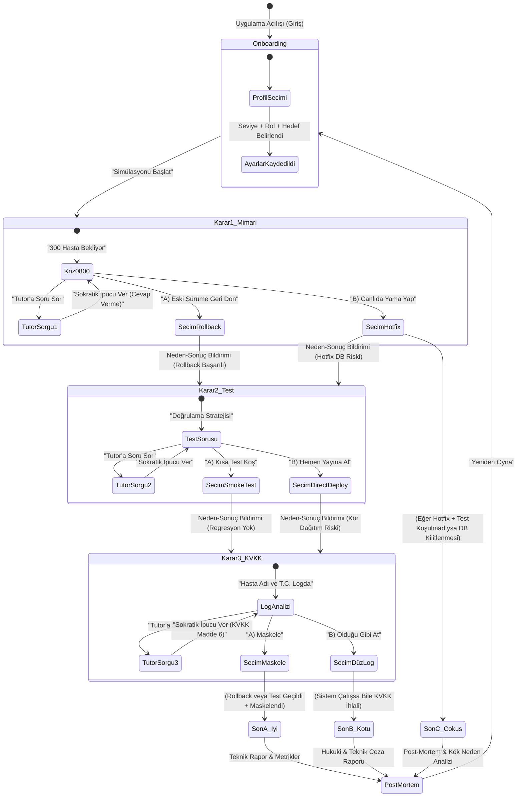
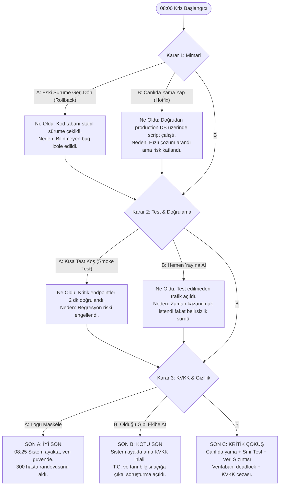

# SE Primer: Kişiselleştirilmiş Yazılım Mühendisliği Kriz Simülasyonu
## Sistem ve Fonksiyonel Spesifikasyon Dokümanı (spec.md)

- **Ders:** YZM301 - Yazılım Mühendisliği
- **Proje:** 1. Hafta Ödevi · SE Primer (The Young Engineer's Illustrated Primer)
- **Tarih:** Ekim 2026
- **Standart:** GitHub Spec-Kit & Sommerville Bölüm 5 (Durum Makineleri) Uyumlu

---

## 1. Problem Tanımı

Yazılım mühendisliği eğitiminde ve meslek hayatına geçişte en büyük eksikliklerden biri, teorik bilgilerin gerçek kriz anlarında nasıl sonuçlar doğurduğunu güvenli bir ortamda deneyimleyememektir. Tipik kriz anları (örneğin sabah saatlerinde çöken kritik bir sağlık sistemi) yazılımcıyı yalnızca teknik bir hata düzeltmeyle değil; **mimari karar alma**, **dağıtım/test risk yönetimi** ve **KVKK / veri gizliliği** boyutlarıyla aynı anda yüzleştirir.

Geleneksel eğitim materyalleri ya statik test soruları sormakta ya da doğrudan doğru cevabı vererek öğrencinin eleştirel düşünme ve Sokratik sorgulama yeteneğini köreltmektedir.

**SE Primer**, Neal Stephenson'ın *The Diamond Age* eserindeki kişiye göre adapte olan etkileşimli kitaptan esinlenerek:
1. Oyuncunun seviyesine (Junior / Senior), rolüne (Backend / DevOps / Fullstack) ve hedefine göre şekillenen,
2. **"08:00, randevu sistemi çöktü. Nöbetçi sensin. Dün gece yeni sürüm çıktı. 300 hasta bekliyor."** krizini yaşatan,
3. Her karardan sonra teknik neden-sonuç analizini ("Ne oldu, neden oldu?") anında sunan,
4. Oyuncuya asla hazır cevabı vermeyen, aksine Sokratik yöntemle düşündürücü karşı sorular soran bir **AI Tutor** rehberliğinde çalışan mobil uyumlu bir mikro simülasyondur.

---

## 2. Kapsam ve Kapsam Dışı (Scope & Out of Scope)

### 2.1. Kapsam Dahilinde Olanlar (In Scope)
- **Mobil Öncelikli Web Uygulaması:** Akıllı telefon ekranlarında (375px - 430px) ve modern web tarayıcılarında akıcı, dokunmatik uyumlu çalışan arayüz.
- **Kişiselleştirme (Onboarding):** Girişte 3 soru:
  1. *Seviye:* Yeni Başlayan (Junior) / Deneyimli (Senior)
  2. *Rol:* Backend / DevOps / Fullstack
  3. *Hedef:* Sistem Güvenilirliği / Hız / Öğrenme
- **Dinamik Oyun Mekaniği:**
  - "Yeni başladım" (Junior) profili: Her karar ekranında otomatik rehber ipuçları ve risksiz düşünme süresi.
  - "Deneyimliyim" (Senior) profili: Gerçekçi stres simülasyonu için **60 saniyelik geri sayım süresi baskısı**; süre biterse varsayılan fail-safe durumu tetiklenir.
- **1 Sağlık Senaryosu, 3 Kritik Karar:**
  - *Karar 1 (Mimari):* A) Eski sürüme geri dön (Rollback) vs B) Canlıda yama yap (Hotfix)
  - *Karar 2 (Test & Doğrulama):* A) Önce kısa test koş (Smoke/Sanity Test) vs B) Hemen yayına al (Direct Deploy)
  - *Karar 3 (KVKK & Gizlilik):* A) Hasta adını ve T.C. kimlik bilgisini maskele vs B) Ekip kanalına olduğu gibi logu at
- **Teknik Neden-Sonuç Analizi:** Her seçimden sonra uygulanan adımın sistem metriklerine etkisi (CPU, DB bağlantı havuzu, hata oranı, bekleyen hasta sayısı) ve mimari gerekçesi açıklanır.
- **En Az 2 Farklı Nihai Son (Dallanma Ağacı):**
  - *Son A (İyi Son):* 08:25 Sistem ayakta, randevular işliyor, veri ve KVKK güvende.
  - *Son B (Kötü Son):* Sistem ayakta veya kısmen çalışıyor ancak KVKK ihlali nedeniyle soruşturma ve itibar kaybı.
  - *Son C (Kritik Çöküş):* Canlıda kontrolsüz yama sonucu veritabanı kilitlenmesi ve sistemin tamamen çökmesi.
- **Sokratik AI Tutor:** Kullanıcı soru sorduğunda veya ipucu istediğinde cevabı ("A şıkkını seç" veya "Geri dönmelisin") ele vermez; öğrenciyi veritabanı şeması, log analizi veya yasal yükümlülükler üzerine düşündürecek karşı sorular ve ipuçları üretir.

### 2.2. Kapsam Dışı (Out of Scope)
- **Kullanıcı Hesabı ve Giriş (Auth):** Kullanıcı kaydı, parola, JWT veya OAuth2 mekanizmaları kurgulanmayacaktır; oturum tarayıcı yerel durumunda (session/state) tutulur.
- **İkinci Bölüm / Çoklu Senaryolar:** Yalnızca 1. hafta için tanımlanan "08:00 Randevu Sistemi Çöküşü" sağlık senaryosu modellenecektir.
- **Gerçek Hasta Verisi:** Hiçbir gerçek şahsi veri kullanılmayacaktır; tüm veriler ve log çıktıları yapay ve sentetik olarak üretilir.
- **Native Mobil Uygulama:** App Store / Google Play native binary (IPA/APK) derlenmeyecektir; Google AI Studio ve mobil tarayıcılarla %100 uyumlu Responsive Web App (PWA uyumlu) geliştirilecektir.

---

## 3. Beş Kabul Örneği (Acceptance Criteria - Gherkin Formatta)

### Kabul Örneği 1 (AC-1): Girişte Kişiselleştirme ve Dinamik Kural Seti
```gherkin
Senaryo: Kullanıcı seviyesine göre kriz dinamiklerinin uyarlanması
  DİYELİM Kİ kullanıcı uygulamayı mobil tarayıcısında açtı
  VE Seviye olarak "Yeni Başladım (Junior)", Rol olarak "Backend", Hedef olarak "Öğrenme" seçti
  EĞER "Simülasyonu Başlat" butonuna tıklarsa
  O ZAMAN sistem sahne ekranına geçer
  VE ekranda "Junior Mühendis Rehber Modu: Sokratik İpuçları Açık" rozeti görüntülenir
  VE 60 saniyelik süre kısıtı devredışı bırakılır.

Senaryo Alternatifi: Deneyimli kullanıcıda süre baskısı
  DİYELİM Kİ kullanıcı Seviye olarak "Deneyimliyim (Senior)" seçti
  EĞER simülasyon başlarsa
  O ZAMAN ekranda 60 saniyeden geriye sayan görsel bir stres zamanlayıcısı belirir
  VE süre sıfıra ulaştığında kullanıcı uyarılır, otomatik güvenli durum eylemi tetiklenir.
```

---

### Kabul Örneği 2 (AC-2): Karar 1 (Mimari Müdahale) ve Neden-Sonuç Açıklaması
```gherkin
Senaryo: Kullanıcının mimari krizde eski sürüme geri dönmeyi seçmesi
  DİYELİM Kİ sistem "08:00 Randevu Sistemi Çöktü, 300 hasta bekliyor" durumundadır
  EĞER kullanıcı "A) Eski sürüme geri dön (Rollback)" seçeneğini seçerse
  O ZAMAN sistem Karar 2 aşamasına geçer
  VE ekranda şu teknik geri bildirim görüntülenir:
    | Ne Oldu?  | Kararlı olan v1.4 sürümüne geri dönme pipeline'ı tetiklendi. |
    | Neden Oldu? | Canlıdaki bilinmeyen hatayı izole etmektense kanıtlanmış stabil koda dönmek riski minimize etti. |
  VE bekleyen hasta sayısı 300'den 210'a düşer, hata oranı %98'den %40'a geriler.
```

---

### Kabul Örneği 3 (AC-3): Karar 2 (Test & Doğrulama) Riski
```gherkin
Senaryo: Test koşmadan doğrudan yayına alma seçimi
  DİYELİM Kİ kullanıcı Karar 1'i tamamlamış ve Karar 2 (Test) aşamasına gelmiştir
  EĞER kullanıcı "B) Hemen yayına al (Test koşma)" seçeneğini seçerse
  O ZAMAN sistem uyarı durumunu "Yüksek Risk" olarak günceller
  VE teknik geri bildirimde: "Canlı ortama test edilmeden kod gönderildi. Birkaç bağımlılık kütüphanesinin sessizce çöktüğü sonradan fark edildi." bilgisi verilir
  VE sistem metriklerinde istikrarsızlık göstergesi artar.
```

---

### Kabul Örneği 4 (AC-4): Karar 3 (KVKK & Gizlilik) ve Nihai Son Dallanması
```gherkin
Senaryo: Loglardaki hasta bilgisini maskelemeden paylaşma (Kötü Son Tetikleyicisi)
  DİYELİM Kİ kullanıcı Karar 3 (KVKK) aşamasına geldi ve loglarda "Ahmet Yılmaz - T.C: 12345678901 - Tanı: Akut Onkoloji" bilgisini gördü
  EĞER kullanıcı "B) Ekibe olduğu gibi logu at" seçeneğini seçerse
  O ZAMAN simülasyon tamamlandığında "SON B · KÖTÜ (Sistem Ayakta ama KVKK İhlali)" ekranına yönlendirilir
  VE ekranda 6698 sayılı Kanun uyarınca idari para cezası ve denetim uyarısı yer alır
  VE teknik raporda "Kişisel sağlık verileri herkese açık iletişim kanalına sızdırıldı" tespiti yazılır.

Senaryo Alternatifi: Maskeleme ile İyi Son
  EĞER kullanıcı "A) Maskele (Regex / Log Sanitization)" seçeneğini seçerse
  O ZAMAN simülasyon "SON A · İYİ (08:25 Sistem Ayakta, Veri Güvende)" ile sonuçlanır
  VE KVKK uyum skoru 100/100 olarak post-mortem raporunda listelenir.
```

---

### Kabul Örneği 5 (AC-5): Sokratik AI Tutor'un Cevabı Ele Vermemesi
```gherkin
Senaryo: Öğrencinin doğrudan cevabı istemesi durumunda Sokratik rehberlik
  DİYELİM Kİ kullanıcı Karar 1 aşamasında AI Tutor'a "Hangi şıkkı seçmeliyim, A mı B mi daha iyi?" sorusunu sordu
  EĞER AI Tutor yanıt üretirse
  O ZAMAN yanıtta "A şıkkını seç", "B'yi seç" veya doğrudan seçenek dayatması KESİNLİKLE yer almaz
  VE AI Tutor şu Sokratik soruyu yöneltir:
    "Geri dönmeden önce dün geceki sürümde veritabanı şemasının (DB schema migration) değişip değişmediğini nasıl anlarsın? Eğer şema değiştiyse eski koda dönmek veritabanını bozar mı?"
  VE öğrenci doğrudan karara değil, teknik analize teşvik edilir.
```

---

### 3.6. Kullanıcı Testi (Playtest) ve "Görünmez Varsayım" Analizi (Ödev 4. Adım İpucu Uygulaması)

> **Ödev İpucu Notu:** *"Bir arkadaşına oynat. İlk takıldığı yer, spec’indeki görünmez varsayımdır. Onu kabul örneği yap."*

Yapılan akran kullanıcı testi (peer playtest) sırasında arkadaşımızın ilk takıldığı nokta: **Senior modunda 60 saniyelik süre baskısı altında karar vermezse ne olacağı belirsizliğiydi**. Sistemde daha önce örtük (görünmez) olarak "kullanıcı seçim yapana kadar bekler" varsayımı mevcuttu. Ancak gerçek bir krizde nöbetçinin hiçbir şey yapmaması sistemin çöküşünü garanti eder.

Bu görünmez varsayım gün yüzüne çıkarılarak **Bonus Kabul Örneği (AC-6)** olarak sisteme işlenmiştir:

```gherkin
Kabul Örneği 6 (AC-6): Senior Stres Süre Aşımı (Time-out Fail-safe Kuralı)
  DİYELİM Kİ kullanıcı Senior modunda simülasyona başladı
  VE 60 saniyelik stres zamanlayıcısı geri sayıyor
  EĞER kullanıcı 60 saniye boyunca hiçbir butona tıklamazsa
  O ZAMAN sistem kilitlenip beklemek yerine otomatik olarak 'Fail-Safe Stabil Durum' eylemini tetikler
  VE ekranda "Süre doldu! Nöbetçi felç oldu, otomatik kriz protokolü devreye girdi" uyarısı belirir
  VE sistem en düşük riskli güvenli hatta (Rollback) çekilir.
```

---

## 4. Durum Makinesi ve Akış Şeması (State Machine & Flowchart)

### 4.1. Durum Makinesi (State Diagram - Sommerville Bölüm 5 Uyumlu)



### 4.2. Karar Matrisi ve Dallanma Şeması



---

## 5. Teknik Neden-Sonuç Geri Bildirim Tablosu

| Aşama | Karar | Ne Oldu? | Neden Oldu? (Teknik Kök Neden) |
|---|---|---|---|
| **Karar 1** | **A) Eski sürüme geri dön** | v1.4 tagine rollback yapıldı, trafik eski konteynerlere yönlendirildi. | Bilinmeyen production hatasını debug etmek yerine çalışırlığı ispatlanmış sürüme dönmek MTTR (Mean Time to Recovery) süresini 4 dakikaya düşürdü. |
| **Karar 1** | **B) Canlıda yama yap** | Production sunucusunda hotfix uygulandı, DB tabloları elle güncellendi. | Dün geceki şema değişikliği ile uyumsuzluk oluştu; veritabanı kilitlendi (table lock), bekleyen istekler timeout oldu. |
| **Karar 2** | **A) Önce kısa test koş** | Otomasyonlu 12 kritik healthcheck ve randevu alma testi 90 saniyede koşuldu. | Dağıtımın gerçekten çalıştığı canlı trafiğe açılmadan önce garanti altına alındı; sessiz çökmeler engellendi. |
| **Karar 2** | **B) Hemen yayına al** | Hiçbir test çalıştırılmadan yük dengeleyici (load balancer) tüm trafiği açtı. | Randevu servisinin önbellek (Redis) bağımlılığı çökmüş durumdaydı; kullanıcılar 502 Bad Gateway hatası almaya devam etti. |
| **Karar 3** | **A) Maskele** | Loglardaki T.C. kimlik ve hasta isimleri regex filtresiyle `***` haline getirildi. | 6698 sayılı KVKK Madde 6 (Özel nitelikli kişisel veriler) korundu; debug sürerken yasal uyumluluk korundu. |
| **Karar 3** | **B) Ekibe olduğu gibi at** | Tüm hasta isimleri, tanı kodları ve kimlik numaraları genel Slack kanalına yollandı. | Üçüncü şahısların ve log toplayıcıların erişebileceği kanala sağlık verisi sızdırıldı; veri güvenliği ihlali raporlandı. |

---

## 6. Sokratik AI Tutor Tasarım Sözleşmesi (AI Tutor Contract)

1. **Kesin Kural 1 (Cevap Yasağı):** Model asla "A seçeneğini seçmelisin", "B yanlıştır", "Rollback yap" gibi yönlendirici emir kipi kullanamaz.
2. **Kesin Kural 2 (Sokratik Yansıtma):** Model öğrencinin sorusunu alıp temel yazılım prensibine (durum yönetimi, idempotentlik, veri bütünlüğü, KVKK) bağlayarak 1 adet düşündürücü soru yöneltir.
3. **Kesin Kural 3 (Rol Odaklılık):** Eğer oyuncu Junior ise ipucunda temel kavramlar (örn. "schema migration", "smoke test") basit bir benzetmeyle hissettirilir; Senior ise mimari riskler (deadlock, transaction isolation, audit log) vurgulanır.

